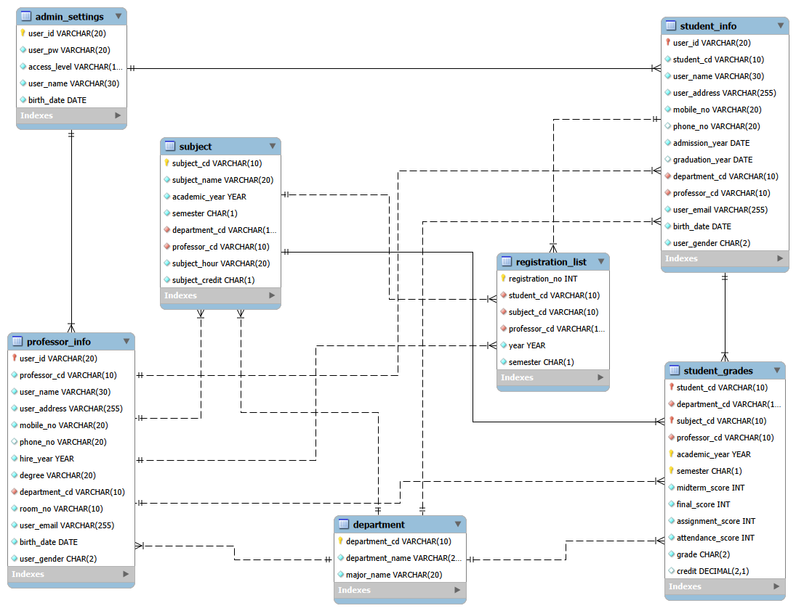

# 학사 관리 프로그램

Java Swing과 MySQL을 활용해 학생·교수·학과·강좌 정보를 관리하는 로컬 데스크톱 프로그램입니다.

## 목차

- [주제](#주제)
- [주요 기능](#주요-기능)
- [시스템 구조](#시스템-구조)
- [기술 스택](#기술-스택)
- [ERD](#erd)
- [보안 보완](#보안-보완)
- [실행 방법](#실행-방법)

## 주제

관리자·교수·학생의 역할에 따라 학사 정보를 관리하고, 수강 신청과 성적 처리를 지원합니다.
Java 화면 구성, JDBC를 통한 DB 연동, SQL 및 트랜잭션 처리를 구현한 포트폴리오 프로젝트입니다.

## 주요 기능

| 사용자 | 기능 |
| --- | --- |
| 관리자 | 학생·교수 정보 관리, 학과 관리, 강좌 개설 관리, 학생·학과 성적 통계 조회 |
| 교수 | 담당 강좌 성적 입력·조회, 성적 통계 조회 |
| 학생 | 수강 신청·취소, 본인 성적 조회 |
| 공통 | 로그인·로그아웃, 내 정보 및 비밀번호 변경 |

수강 신청 시 정원 15명과 학기당 최대 18학점을 확인하고, 트랜잭션으로 수강 내역과 성적 기록을 함께 처리합니다.

## 시스템 구조

```text
Java Swing 화면 → JDBC → MySQL
```

사용자의 PC에서 실행하며, 환경 변수에 설정한 전용 DB 계정으로 로컬 MySQL에 접속합니다.

## 기술 스택

| 구분 | 기술 |
| --- | --- |
| 언어 | Java 11 이상 |
| 화면 | Java Swing |
| 데이터베이스 | MySQL 8 |
| DB 연동 | JDBC, MySQL Connector/J |
| 빌드 | Maven |
| 개발 환경 | IntelliJ IDEA |

## ERD



테이블과 샘플 데이터는 [university_full.sql](database/university_full.sql)에서 확인할 수 있습니다.

## 보안

- 각 화면의 실행 진입점을 로그인 화면으로 연결
- 비밀번호를 PBKDF2 해시로 저장하고, 무작위 임시 비밀번호와 최초 로그인 시 변경 적용
- 현재 비밀번호 확인 후 새 비밀번호를 12자로 설정
- DB 접속 정보를 환경 변수로 관리하고 전용 DB 계정 사용

## 실행 방법

1. IntelliJ에서 `pom.xml`을 Maven 프로젝트로 엽니다.
2. MySQL에 `university` DB를 만들고 `database/university_full.sql`을 실행합니다.
3. 전용 DB 계정을 생성하고 `UNIVERSITY_DB_USER`, `UNIVERSITY_DB_PASSWORD` 환경 변수를 설정합니다.
4. `학사관리프로젝트.Login`을 실행합니다.

새 DB의 샘플 관리자 계정은 `a101 / 760201`이며, 첫 로그인 후 비밀번호를 변경합니다.
전체 SQL은 기존 테이블을 삭제하므로 이미 사용 중인 DB에는 재실행하지 않습니다.

자세한 계정 설정과 기존 DB 전환 방법은 [실행 안내](SETUP.md)를 참고하세요.
